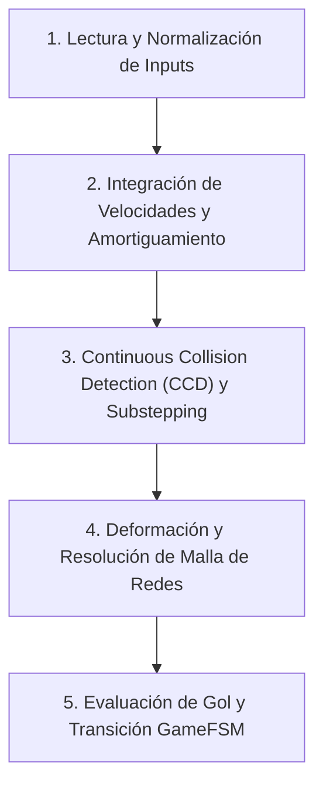

# TECHNICAL ARCHITECTURE SPECIFICATION — LEGACYX-GO
**Versión:** 1.0.0-CANONICAL  
**Estado:** VIGENTE / NORMA ARQUITECTÓNICA DE OBLIGADO CUMPLIMIENTO  
**Ámbito:** Todo el Monorepo (`@legacyx/core`, `@legacyx/client`, `@legacyx/server`)

---

## 1. ARQUITECTURA DESACOPLADA EN TRES CAPAS

LegacyX-GO se cimenta sobre una estricta segregación de responsabilidades dividida en tres estratos independientes:

```
+-----------------------------------------------------------------------------------+
|                           CAPA 1: UI DECLARATIVA SVELTE 5                         |
|   (Lobby, HUD, Modales de Ajustes, Marcador, Chat, Estadísticas Post-Match)        |
|   - Exclusividad Runes: $state, $derived, $props, $effect                         |
|   - Estilos estrictamente encapsulados (<style scoped>)                            |
+-----------------------------------------+-----------------------------------------+
                                          | Eventos de usuario / Estado UI
                                          v
+-----------------------------------------------------------------------------------+
|                        CAPA 3: RENDERIZADOR CANVAS 2D                             |
|   - requestAnimationFrame desacoplado del tick físico (60 - 144+ FPS)              |
|   - Interpolación Lineal Continua (lerp con factor alpha acumulado)               |
|   - Game Feel: Screen Shake sutil, estelas de plasma (Magnus), redes elásticas    |
|   - Cero sobrecoste de dibujo (sin filtros costosos como backdrop-filter: blur)   |
+-----------------------------------------+-----------------------------------------+
                                          | Lectura de estados (Snapshot Lerp)
                                          v
+-----------------------------------------------------------------------------------+
|                      CAPA 2: MOTOR MATEMÁTICO HEADLESS ISOMÓRFICO                 |
|                               (@legacyx/core)                                     |
|   - TypeScript plano puro, cero dependencias de DOM/Browser APIs                  |
|   - Frecuencia temporal fija invariable: Delta t = 1/60s (60 Hz deterministas)    |
|   - Ejecutable en: Dedicated Web Worker (Cliente) / Node.js (VPS Salas 24/7)      |
+-----------------------------------------------------------------------------------+
```

---

### 1.1 Capa 1: Frontend Declarativo en Svelte 5 (`packages/client/src/ui/`)
* **Paradigma Reactivo Moderno:** Uso obligatorio y exclusivo de las Runes de Svelte 5:
  - `$state`: Para valores reactivos mutables locales o de componentes.
  - `$derived`: Para cálculos computados puros (evitar efectos colaterales).
  - `$props`: Para la interfaz de propiedades estrictamente tipadas en TypeScript.
  - `$effect`: Únicamente para sincronización con APIs externas (Web Audio, Canvas bindings, WebRTC events). Prohibido utilizar `$effect` para mutar otros estados reactivos.
  - **Prohibición:** Código legado de Svelte 3/4 (`export let`, reactividad `$:` o Svelte stores manuales innecesarios).
* **Encapsulamiento Estricto de Estilos:** Todo el diseño e integración de pantallas procedentes de Google Stitch debe confinarse estrictamente dentro de la etiqueta `<style>` del componente. Prohibido inyectar selectores globales que contaminen o reseteen otras vistas de la aplicación.

---

### 1.2 Capa 2: Motor Headless Isomórfico (`packages/core/`)
* **Aislamiento Total:** El núcleo matemático no conoce la existencia del objeto `window`, `document`, `HTMLElement` ni ningún subsistema de renderizado.
* **Isomorfismo Cliente-Servidor:**
  - **En Cliente:** Se ejecuta dentro de un **Dedicated Web Worker** (`physics.worker.ts`). Esto garantiza que si la pestaña pierde el foco o el hilo principal de la UI/DOM se satura, el bucle físico a 60 Hz no sufre *throttling* ni desincronización.
  - **En Servidor:** Se ejecuta de forma nativa en Node.js para actuar como árbitro autoritativo en salas comunitarias headless 24/7 sin entorno gráfico.

---

### 1.3 Capa 3: Renderer Gráfico HTML5 Canvas 2D (`packages/client/src/renderer/`)
* **Desacoplamiento Temporal e Interpolación (*Lerp*):**
  El ciclo de renderizado corre libremente en `requestAnimationFrame` al refresco del monitor (60 Hz, 120 Hz, 144 Hz o 240 Hz). Para erradicar el *stuttering* y saltos de fotogramas, la posición visual de cada entidad se interpola entre el estado físico previo y el estado actual:

  $$\vec{P}_{\text{render}} = \vec{P}_{\text{prev}} + (\vec{P}_{\text{curr}} - \vec{P}_{\text{prev}}) \cdot \alpha$$

  Donde $\alpha \in [0, 1)$ representa la fracción de tiempo transcurrida desde el último tick físico:
  $$\alpha = \frac{t_{\text{acumulado}}}{\Delta t_{\text{físico}}}$$

---

## 2. PRINCIPIO DE FÍSICAS CINEMÁTICAS SECUENCIALES

Cada tick de simulación física en `@legacyx/core` ($\Delta t = 1/60\text{ s}$) se ejecuta de forma estrictamente secuencial y determinista en 5 fases inalterables:



### Detalle de las Fases del Tick Físico:
1. **Lectura y Normalización de Inputs:**
   - Consumo de paquetes de entrada del buffer (teclado, ratón o joystick virtual).
   - Normalización del vector de dirección ($\|\vec{v}_{\text{input}}\| \le 1.0$).
2. **Integración de Velocidades y Amortiguamiento:**
   - Aplicación de aceleraciones, fuerza de patada o dash a los jugadores.
   - Aplicación del vector lateral Magnus sobre el balón: $\vec{a}_{\text{Magnus}} = C_M \cdot \omega \cdot (-v_y, v_x)$.
   - Integración de Euler semi-implícita:
     $$\vec{v}_{t+1} = \vec{v}_t \cdot \mu + \vec{a} \cdot \Delta t$$
     $$\vec{x}_{t+1} = \vec{x}_t + \vec{v}_{t+1} \cdot \Delta t$$
3. **Continuous Collision Detection (CCD) y Substepping:**
   - Verificación de desplazamiento proyectado del balón $d = \|\vec{v}\| \cdot \Delta t$.
   - Si $d > r_{\text{balón}}$, se subdivide el tick en $N = \lceil d / r_{\text{balón}} \rceil$ sub-pasos con colisiones de barrido (*swept circles* / *raycasts*) contra postes, vallas y discos de jugadores.
4. **Deformación y Resolución Elástica de Mallas de Arcos (`GoalNet`):**
   - Integración del sistema masa-resorte subamortiguado que conforma las redes de cada portería.
   - Amortiguamiento cinético del balón cuando penetra el volumen de la red.
5. **Evaluación de Intersección de Gol y Transición de la GameFSM:**
   - Verificación del cruce total del centro y radio del balón tras la línea de meta interior.
   - Si se confirma gol: congelación inmediata de movimiento de jugadores, disparo del evento sonoro/visual y transición a `GameState.GOAL` por 3.0 segundos.

> [!CAUTION]
> **Prohibición Absoluta de Motores Externos:**
> Queda terminantemente prohibido importar motores físicos de terceros (como Matter.js, Box2D, Planck.js o Cannon.js). La física de LegacyX-GO debe ser TypeScript determinista plano con aritmética escalar y vectorial nativa, garantizando paridad matemática exacta en todas las plataformas y cero riesgos de licencias.

---

## 3. OPTIMIZACIÓN VISUAL Y CONTROL DE SOBREDIBUJADO (OVERDRAW)

Para asegurar 60-144 FPS estables en hardware modesto (tarjetas integradas Intel UHD, dispositivos móviles y laptops económicas):

1. **Eliminación de Filtros Costosos en Tiempo Real:**
   - **Prohibido:** `backdrop-filter: blur(...)` en elementos de interfaz sobre el Canvas activo (impacto severo en la GPU en navegadores móviles y Safari).
   - **Estándar:** Uso de paletas translúcidas optimizadas precalculadas (ej. `rgba(10, 16, 26, 0.96)` o gradientes CSS lineales estáticos).
2. **Optimización del Pipeline de Canvas 2D:**
   - **Cero Overdraw de Capas Vacías:** El bucle de renderizado solo emite órdenes de pintado para entidades activas en el viewport.
   - **Batching de Renderizado:** Agrupamiento de trazos por estilo (un solo `beginPath() / stroke()` para las líneas de demarcación del campo).
   - **Gestión de Partículas:** Límite máximo de 128 partículas activas en el pool de estela de tiro/fuego. Las partículas inactivas se reciclan en memoria sin generar asignaciones continuas en el Garbage Collector.

---

## 4. PROTOCOLO DE CALIDAD TEMPRANA (SHIFT-LEFT TESTING)

La suite de validación y pruebas automatizadas reside en `packages/core/tests/` ejecutada mediante `vitest`:

### 4.1 Benchmark de Invariabilidad Determinista (Golden Test)
* **Requisito:** Una simulación continua de **3,600 ticks** (equivalente a 60 segundos de partido a 60 Hz) con una semilla pseudoaleatoria fija e inputs grabados debe arrojar exactamente el mismo hash binario (`SHA-256`) de estado en cualquier entorno (Node.js en CI, Linux, macOS o Windows).
* Si una refactorización matemática altera el hash sin justificación técnica aprobada, la prueba falla y bloquea el merge.

### 4.2 Pruebas de Resiliencia del JitterBuffer y Red P2P
* Validación de algoritmos de descarte, interpolación y compensación de latencia bajo perfiles adversos simulados:
  - Latencia media: $120\text{ ms}$ (RTT de $240\text{ ms}$).
  - Pérdida de paquetes inducida: $5\%$.
  - Jitter aleatorio: $\pm 25\text{ ms}$.

### 4.3 Robustez del Hilo Físico ante Desconexión o Pérdida de Foco
* Desconexión o reconexión en caliente de mandos/gamepads.
* Cambio de pestaña activa (`document.hidden = true`): la ejecución en Web Worker asegura que el partido no se detenga para el resto de peers en la sala.

---

## 5. DIRECTIVAS PONYTAIL (YAGNI / CÓDIGO LIMPIO)

1. **Cero Abstracciones Prematuras:** No crear interfaces, fábricas o capas de mediación para casos hipotéticos ("por si en el futuro se añade soporte 3D"). Solo se implementa el código requerido por las especificaciones activas del GDD.
2. **Prevalencia de Tipos Primitivos y Estructuras Planas:**
   - Empleo de `Float32Array` o tuplas numéricas para buffers de datos de alta frecuencia.
   - Evitar jerarquías profundas de clases orientadas a objetos; privilegiar composición y funciones puras siempre que sea posible.
3. **Auditoría de Cierre de Fase:** Antes de dar por concluida cualquier etapa de desarrollo, se ejecutará una auditoría estricta para eliminar dependencias huérfanas, tipos no referenciados y archivos de prueba temporales.
