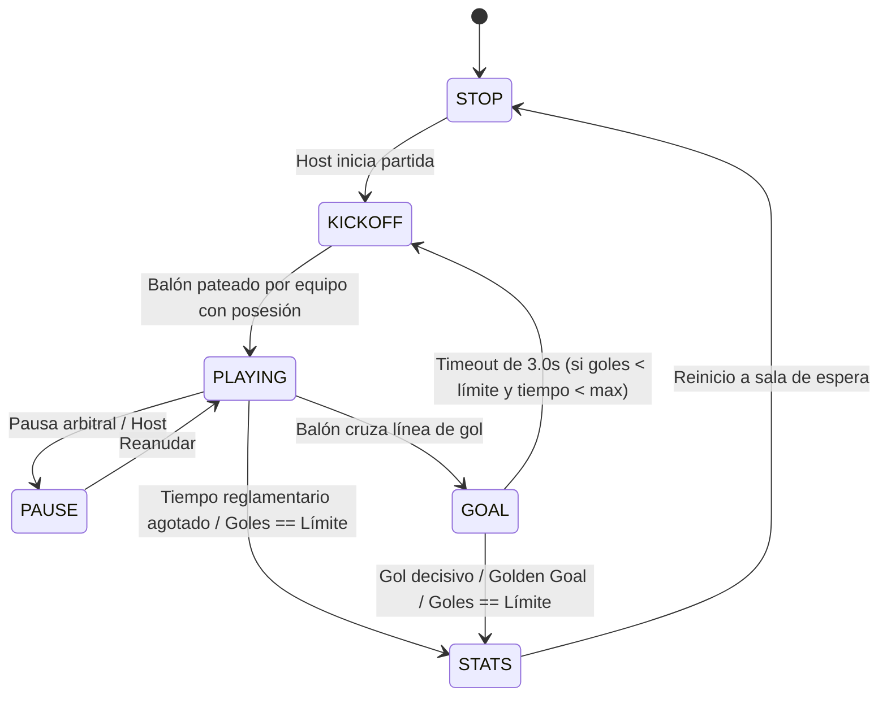

# CANONICAL GAME DESIGN DOCUMENT (GDD) — LEGACYX-GO
**Versión:** 1.0.0-CANONICAL  
**Estado:** VIGENTE / NORMA CANÓNICA  
**Subsistema Primario:** Core Headless Engine (`@legacyx/core`) & Render (`@legacyx/client`)

---

## 1. VISIÓN E IDENTIDAD DEL JUEGO

### 1.1 Concepto de Alto Nivel
**LegacyX-GO** es un simulador deportivo 2D multijugador competitivo de fútbol físico con vista cenital (*top-down*). El juego se fundamenta en la traslación cinemática, impulsos vectoriales elásticos entre discos rígidos (jugadores y balón) y la deformación elástica no lineal de redes de portería.

```
       +-------------------------------------------------------+
       |                       CANCHA 2D                       |
[PORTERÍA A]  (D) Jugador A                     Jugador B (D)  [PORTERÍA B]
(Red Elástica)               (O) Balón                         (Red Elástica)
       |                                                       |
       +-------------------------------------------------------+
```

### 1.2 Experiencia Core y Pilares de Diseño
1. **Cero Fricción de Entrada:** Acceso instantáneo en navegadores modernos mediante tecnología WebRTC DataChannels P2P (mesh/star con host autoritativo) sin instalaciones, plugins ni descargas pesadas.
2. **Determinismo y Fidelidad Mecánica:** Cada rebote, tiro con comba (*Efecto Magnus*) y fricción se calcula a una tasa invariable de 60 Hz. Dos clientes ejecutando la misma secuencia de inputs obtendrán una simulación matemáticamente idéntica.
3. **Persistencia e Interoperabilidad Headless:** El motor físico es 100% isomórfico y desacoplado del DOM/Canvas, permitiendo su despliegue en Dedicated Web Workers (cliente) y Node.js/Linux VPS para salas comunitarias headless activas 24/7.
4. **Respuesta Táctil y *Game Feel* Inmersivo:** Micro-animaciones, amortiguamiento elástico de redes y screen shake sutil en impactos de poste transmiten la energía cinemática de cada jugada sin comprometer la claridad competitiva.

---

## 2. MÁQUINA DE ESTADOS FINITA (GameFSM)

El ciclo de vida de un partido se rige por una máquina de estados finita determinista que sincroniza al host y a los clientes.

### 2.1 Definición de Estados Canónicos

| Estado | ID Numérico | Nombre Enum | Descripción Operativa | Reglas de Física / Timers |
| :--- | :---: | :--- | :--- | :--- |
| **STOP** | `0` | `GameState.STOP` | Partida no iniciada o finalizada. Jugadores libres para posicionarse o esperar. | Cronómetro de partido congelado. Balón bloqueado en el centro. |
| **KICKOFF** | `1` | `GameState.KICKOFF` | Saque inicial tras inicio de periodo o gol. | Balón estático en $(0, 0)$. Barrera de medio campo activa (jugadores no pueden invadir campo rival hasta el primer toque del equipo sacador). |
| **PLAYING** | `2` | `GameState.PLAYING` | Partido en juego activo continuo. | Simulación física completa libre. Cómputo de posesión por tick, avance del cronómetro de partido reglamentario. |
| **PAUSE** | `2.1` | `GameState.PAUSE` | Interrupción táctica solicitada por host/árbitro. | Simulación cinemática congelada. Buffers de inputs en pausa. |
| **GOAL** | `3` | `GameState.GOAL` | Balón ha traspasado íntegramente la línea de meta. | Discos de jugadores bloqueados cinemáticamente ($v = 0$). Física de red activa para disipar energía del balón. Duración estricta: **3.0 segundos**. Transiciona a `KICKOFF` (o `STATS` si se alcanza tiempo/límite). |
| **STATS** | `5` | `GameState.STATS` | Fin reglamentario o por límite de goles. | Fin de simulación física. Cálculo de métricas: posesión, tiros al arco, pases, MVP del partido y despliegue del panel resumen. |

### 2.2 Diagrama de Transición de Estados



---

## 3. PARÁMETROS Y CONSTANTES FÍSICAS INVARIABLES

Toda unidad espacial se mide en **píxeles virtuales canónicos ($px$)** y el tiempo en **segundos ($s$)**.

### 3.1 Paso Temporal Fijo (Fixed Timestep)
$$\Delta t = \frac{1}{60}\text{ s} \approx 0.016666667\text{ s} \quad (60\text{ Hz})$$
* **Regla Inquebrantable:** Queda terminantemente prohibido utilizar el `deltaTime` variable de `requestAnimationFrame` para la integración física. Toda actualización matemática responde al multiplicador constante $\Delta t$.

### 3.2 Entidades Cinemáticas Base

| Entidad | Radio ($r$) | Masa ($m$) | Fricción Lineal / Amortiguamiento ($\mu$) | Restitución / Rebote ($e$) | Límite Velocidad ($v_{\max}$) |
| :--- | :---: | :---: | :---: | :---: | :---: |
| **Balón** | $10\text{ px}$ | $0.20$ | $0.990$ por tick ($\approx -1\%\text{ vel/tick}$) | $0.80$ (contra postes/vallas) | $950\text{ px/s}$ |
| **Disco Jugador** | $15\text{ px}$ | $1.00$ | $0.920$ por tick (desaceleración activa) | $0.50$ (cuerpo a cuerpo) | $320\text{ px/s}$ (normal) / $520\text{ px/s}$ (dash) |
| **Postes de Arco** | $8\text{ px}$ | $\infty$ (estático) | N/A | $0.85$ (alta elasticidad acústica) | $0$ |

### 3.3 Mecánica del Efecto Magnus (Comba en Tiros Curvos)
El balón acumula velocidad angular ($\omega$, en radianes/s) cuando un jugador impacta el balón con un ángulo excéntrico respecto a su vector de avance o mediante el comando de tiro con efecto:

$$\vec{a}_{\text{Magnus}} = C_M \cdot \omega \cdot \begin{pmatrix} -v_y \\ v_x \end{pmatrix}$$

* $C_M = 0.0025$ (Coeficiente de sustentación lateral Magnus).
* Disipación de Spin: $\omega_{t+1} = \omega_t \cdot 0.985$ por tick.
* **Umbral Visual:** Cuando $\|\vec{v}_{\text{balón}}\| \ge 900\text{ px/s}$, el renderizador activa la estela de fuego y partículas de plasma.

### 3.4 Substepping y Continuous Collision Detection (CCD)
Para prevenir la tunelización del balón a velocidades extremas ($> 600\text{ px/s}$ a $950\text{ px/s}$):
1. **Cálculo de Desplazamiento Proyectado:** En cada tick, se evalúa $d = \|\vec{v}_{\text{balón}}\| \cdot \Delta t$.
2. **Criterio de Subdivisión:** Si $d > r_{\text{balón}}$ ($10\text{ px}$):
   $$N_{\text{substeps}} = \left\lceil \frac{d}{r_{\text{balón}}} \right\rceil$$
3. La integración se ejecuta en $N_{\text{substeps}}$ micro-pasos con $\delta t = \frac{\Delta t}{N_{\text{substeps}}}$, realizando pruebas de intersección círculo-círculo y círculo-segmento (raycast / swept circle) contra postes, vallas y discos.

### 3.5 Redes Elásticas de Portería (`GoalNet`)
La red de cada portería se compone de una retícula de nodos discretizados interconectados por resortes elásticos subamortiguados:
* **Ecuación del Resorte:** $\vec{F}_s = -k \cdot (\|\Delta\vec{x}\| - L_0) \cdot \hat{u} - c \cdot (\vec{v}_1 - \vec{v}_2)$
* $k = 0.45$ (Elasticidad estructural).
* $c = 0.12$ (Coeficiente de amortiguamiento viscoso).
* Los nodos traseros y laterales están fijados al marco del arco; los nodos frontales reaccionan al volumen esférico del balón amortiguando su energía cinética hacia reposo.

---

## 4. ESPECIFICACIÓN CANÓNICA DE ESTADIOS OFICIALES

Todos los estadios tienen origen $(0, 0)$ en el centro geométrico del campo.

```
       (-W/2, -H/2) ---------------- (W/2, -H/2)
             |                             |
      [-Goal]|          (0,0)              |[+Goal]
             |                             |
       (-W/2,  H/2) ---------------- (W/2,  H/2)
```

| Estadio | Ancho ($W$) | Alto ($H$) | Apertura de Arco ($H_g$) | Profundidad Arco ($D_g$) | Radio Círculo Central | Capacidad Sugerida |
| :--- | :---: | :---: | :---: | :---: | :---: | :---: |
| **AF 3v3** (Oficial) | $840\text{ px}$ | $400\text{ px}$ | $120\text{ px}$ | $45\text{ px}$ | $70\text{ px}$ | 3 vs 3 (Competitivo) |
| **Classic Stadium** | $800\text{ px}$ | $360\text{ px}$ | $110\text{ px}$ | $40\text{ px}$ | $60\text{ px}$ | 2 vs 2 / 3 vs 3 |
| **Big Stadium** | $1100\text{ px}$ | $500\text{ px}$ | $140\text{ px}$ | $55\text{ px}$ | $90\text{ px}$ | 4 vs 4 / 5 vs 5 |
| **Small Arena** | $600\text{ px}$ | $300\text{ px}$ | $90\text{ px}$ | $35\text{ px}$ | $50\text{ px}$ | 1 vs 1 / Entrenamiento |

* **Coordenadas de Postes (Ejemplo AF 3v3):**
  - Arco Rojo (Izquierdo, $x = -420$): Poste Superior $(-420, -60)$, Poste Inferior $(-420, 60)$.
  - Arco Azul (Derecho, $x = +420$): Poste Superior $(+420, -60)$, Poste Inferior $(+420, 60)$.

---

## 5. CATÁLOGO DE LOS 19 MODIFICADORES FÍSICOS

Configuración dinámica del motor para modos personalizados, salas *modded* o torneos comunitarios:

| # | Nombre Descriptivo | Clave Interna | Valor Default | Rango Válido (Min - Max) | Unidad / Efecto Mecánico |
| :-: | :--- | :--- | :---: | :---: | :--- |
| **1** | Gravedad / Inclinación | `gravity` | `0.0` | `-50.0` .. `+50.0` | $\text{px/s}^2$ aplicada al eje vertical o vector de inclinación |
| **2** | Fricción del Campo | `pitchFriction` | `0.990` | `0.900` .. `0.999` | Coeficiente multiplicador de velocidad por tick |
| **3** | Rebote de Vallas | `wallBounciness` | `0.80` | `0.10` .. `1.20` | Coeficiente de restitución contra bordes perimetrales |
| **4** | Rebote de Postes | `postBounciness` | `0.85` | `0.20` .. `1.30` | Coeficiente de restitución contra cilindros de postes |
| **5** | Fuerza de Patada Base | `baseKickStrength` | `450.0` | `200.0` .. `900.0` | $\text{px/s}$ transferidos al balón en impacto intencional |
| **6** | Potencia de Dash / Sprint | `dashPower` | `280.0` | `100.0` .. `600.0` | Impulso instantáneo adicional al vector de movimiento |
| **7** | Cooldown de Dash | `dashCooldown` | `1.5` | `0.2` .. `5.0` | Segundos de recarga antes de un nuevo impulso |
| **8** | Masa de Jugadores | `playerMass` | `1.0` | `0.5` .. `3.0` | Relación de inercia en choques disco vs disco |
| **9** | Radio de Jugadores | `playerRadius` | `15.0` | `10.0` .. `25.0` | Píxeles de envolvente de colisión circular |
| **10** | Masa del Balón | `ballMass` | `0.20` | `0.05` .. `1.00` | Inercia y aceleración reactiva del balón |
| **11** | Radio del Balón | `ballRadius` | `10.0` | `6.0` .. `20.0` | Radio para cálculo de colisión e intersección de gol |
| **12** | Coeficiente Magnus | `magnusCoefficient` | `0.0025` | `0.0` .. `0.010` | Magnitud de la curva generada por spin angular |
| **13** | Elasticidad de Redes | `netElasticity` | `0.45` | `0.10` .. `0.90` | Constante $k$ de resortes de la malla de arcos |
| **14** | Amortiguamiento de Redes | `netDamping` | `0.12` | `0.02` .. `0.50` | Factor de disipación viscosa $c$ en la red |
| **15** | Duración de Celebración | `goalCelebrationDuration` | `3.0` | `1.0` .. `6.0` | Segundos en estado `GOAL` antes de resetear a kickoff |
| **16** | Límite de Goles | `goalLimit` | `3` | `1` .. `15` | Goles necesarios para finalizar la partida (0 = infinito) |
| **17** | Tiempo Reglamentario | `matchTimeMinutes` | `3.0` | `1.0` .. `15.0` | Minutos de juego activo antes de concluir o ir a overtime |
| **18** | Overtime / Gol de Oro | `goldenGoalOvertime` | `true` | `true` / `false` | Determina si el empate al límite de tiempo abre prórroga a 1 gol |
| **19** | Densidad del Aire | `airDensity` | `1.0` | `0.0` .. `3.0` | Factor de resistencia y fricción aerodinámica superior |

---

## 6. CONTROLES Y MAPEO DE INPUTS

### 6.1 Teclado y Ratón (Desktop)
* **Movimiento:** `WASD` o Flechas Direccionales ($\vec{d}_{\text{input}}$ normalizado a longitud $\le 1.0$).
* **Patear / Interacción Balón:** Barra Espaciadora o Clic Izquierdo del ratón.
* **Dash / Sprint:** `Shift` Izquierdo o Clic Derecho del ratón.

### 6.2 Dispositivos Táctiles (Mobile)
* **Stick Virtual Izquierdo:** Joystick dinámico analógico flotante con deadzone de $12\%$ y radio de arrastre de $50\text{ px}$.
* **Botones de Acción Derechos:**
  - Botón Primario: Patada (icono de bota/balón).
  - Botón Secundario: Dash (icono de rayo con indicador radial de cooldown).
